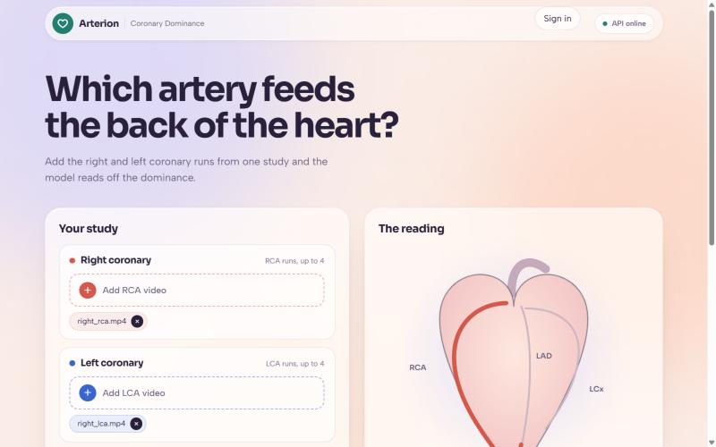

# Arterion Coronary Dominance

[](https://github.com/kartikpagariya25/arterion-coronary-dominance/actions/workflows/test.yml)  

Predicts whether a patient is **right- or left-dominant** (which coronary artery supplies the posterior descending branch) from the right- and left-coronary angiogram runs of one study.



> **Research prototype — not a medical device.** Do not use for diagnosis or treatment decisions.

Part of the [Arterion](https://github.com/kartikpagariya25/Arterion) project.

## How it works

`DominanceNet`: each angiogram run is reduced to 4 evenly spaced frames; a shared ImageNet-pretrained **ResNet-18** encodes the frames, features are averaged over frames, a learned **view embedding** (RCA / LCA) is appended, an MLP produces per-run logits, and a study's logits are averaged across its runs. Trained class-weighted with label smoothing, AdamW, cosine schedule, early stopping on validation balanced accuracy. Input resolution 160 px; the model is exported to ONNX (11.2 M parameters).

## Results

Data: [CoronaryDominance](https://huggingface.co/datasets/BearSubj13/CoronaryDominance) `main_normal` subset — **779 studies** (251 left / 528 right, 5,157 runs). Stratified **study-level** split 70 / 15 / 15 (seed 42); metrics are on the 117 untouched test studies.

| Input at inference | AUROC | Balanced accuracy |
|---|---|---|
| Training-style evaluation (up to 4 runs / study) | **0.996** | **0.961** |
| One RCA run + one LCA run (what the web app typically sends) | 0.987 | 0.943 |
| One RCA run only | 0.971 | 0.936 |
| One LCA run only | 0.950 | 0.884 |

Confusion matrix (rows = truth right/left): `[[77, 2], [2, 36]]`. Files: `training/artifacts/metrics.json`, `api_view_ablation.json`.

**Caveats.** Studies are anonymised, so several studies of one patient may sit on both sides of the split; this would inflate the numbers. The data is single-centre, and the model has not been evaluated on the dataset's `real_distribution` or `domain_shift` sets. Treat the figures as an upper bound.

## Accounts, history and the doctor dashboard

Sign in from the top of the site to keep a history of your dominance readings. Without an account everything still works; results just are not saved.

- **Patients** register with an email and password. Every analysis they run while signed in is saved (the findings, not images or long signals) and listed on `history.html`, together with any note a doctor adds. They can delete single analyses, change their password or delete their account and all of its data.
- **Doctors** get a dashboard on the same page: *Awaiting review*, *All analyses* (filter by type, status or patient), *Patients* and *My analyses*. They open any analysis and write a review note that the patient sees.
- **Doctor sign-up needs an invite code.** Set `DOCTOR_INVITE_CODE` on the backend; with it unset, doctor registration is disabled. To create the first doctor (or reset a forgotten password; there is no email reset):

```bash
cd backend
python -m app.accounts.cli create-user --email doc@example.com --name "Dr Doc" --role doctor
python -m app.accounts.cli set-password --email someone@example.com
```

Under the hood: SQLite, passwords hashed with scrypt, HS256 JWTs, and a lockout after five failed logins per email (15 minutes). See [SECURITY.md](SECURITY.md) for what this does and does not protect.

| Setting | Default | Meaning |
|---|---|---|
| `DATA_DIR` | `backend/data` (a Docker volume in compose) | where `arterion.db` and the generated JWT secret live |
| `JWT_SECRET` | generated once, kept in `DATA_DIR` | signing key; set it to share tokens between replicas |
| `JWT_EXPIRE_MINUTES` | `480` | token lifetime |
| `DOCTOR_INVITE_CODE` | empty (doctor sign-up off) | code required to register as a doctor |
| `REQUIRE_AUTH` | off | `1` makes every endpoint, uploads included, require a signed-in user |

| Endpoint | Who | Purpose |
|---|---|---|
| `POST /auth/register`, `POST /auth/login` | anyone | create an account / get a token |
| `GET /auth/me`, `POST /auth/password`, `DELETE /auth/me` | signed in | profile, change password, delete account and data |
| `GET /history`, `GET /history/{id}`, `DELETE /history/{id}` | signed in | the caller's own saved analyses |
| `GET /history/export.csv` | signed in | the caller's saved analyses as a CSV file |
| `GET /history/series?task=` | signed in | the headline value (probability of left dominance) of each saved analysis for that task, oldest first, for charting |
| `GET /doctor/analyses/export.csv` | doctor | all analyses as CSV; filter with `patient_id`, `task`, `reviewed` |
| `GET /doctor/patients/{id}/series?task=` | doctor | the same series for one patient |
| `GET /health`, `GET /ready` | anyone | liveness, and readiness (database and upload directory) |
| `GET /doctor/patients`, `GET /doctor/analyses[/{id}]` | doctor | all patients and their analyses |
| `POST /doctor/analyses/{id}/review` | doctor | add or update a review note |

Prediction endpoints take an optional `Authorization: Bearer <token>`; when present the result is saved and the response carries an `X-History-Id` header.

## Design

The site follows one landing-page system: a floating navigation (logo mark, centre pills, sign-in, Get Started), a hero with a serif headline and an italic gradient second line, six feature cards, a four-step process, the working tool, a dark evidence section with the real held-out metrics, a call to action and a footer.

- **Palette:** emerald green and white. Tokens live in `frontend/css/theme.css`.
- **Type:** Libre Baskerville for headlines, DM Sans for text, Spline Sans Mono for numbers.
- **Motion:** GSAP ScrollTrigger drives scroll progress, reveals, the rail that connects the steps and the metric bars. Motion (the vanilla build of the Framer Motion engine) drives the hero entrance, button springs and count-ups. Everything collapses to a static page under `prefers-reduced-motion`.
- **Themes:** light and dark. The toggle in the navigation follows your system until you choose, and remembers the choice. Tokens for both live in `frontend/css/theme.css`.
- **Details:** see [DESIGN.md](DESIGN.md).


## Run it

```bash
./scripts/fetch_weights.sh        # or .\scripts\fetch_weights.ps1  (GitHub Release)
docker compose up --build
# site: http://localhost:8080     API docs: http://localhost:8000/docs
```

Without Docker: `cd backend && pip install -r requirements-dev.txt && uvicorn app.main:app --port 8000`, then serve `frontend/`. The site talks to `window.API_BASE` (`frontend/js/config.js`). Two held-out sample studies (CC0 data, re-encoded to small MP4s) are bundled.

### API

| Endpoint | Body | Returns |
|---|---|---|
| `POST /uploads` | multipart `file` | `{file_url}` |
| `POST /dominance/predict` | `{videos: [{file_url, view: "RCA"\|"LCA"}, …]}` (1–8) | `dominance_type`, `confidence`, `p_left`, `views_used`, `per_video` |

Each file may be a video (MP4/AVI), an `.npz` with a `pixel_array` (frames, H, W) array, or a single image. Wrong media returns 422 with a readable `detail`.

Tests: `cd backend && pytest tests`.

## Training

`training/src`: `build_cache.py` (index, split, frame cache) → `train.py` → `evaluate.py` → `export_onnx.py` (parity-checked) → `infer.py`. Real dataset structure and decisions are in `training/STATUS.md`.

## Documentation

- [Model card](MODEL_CARD.md): data, results and limitations
- [Changelog](CHANGELOG.md)
- No Docker? Run `scripts/run_local.ps1` (Windows) or `scripts/run_local.sh` (macOS/Linux); it creates a virtual environment, starts the API on 8000 and the site on 8080. Needs Python 3.11.
- [Deployment](docs/DEPLOYMENT.md): configuration, health checks, backups and putting it on a server
- [Contributing](CONTRIBUTING.md)
- [Security and privacy](SECURITY.md)

## Data and licences

Code: MIT. Dataset: Kruzhilov et al., *Scientific Data* 2025, CC0-1.0.
